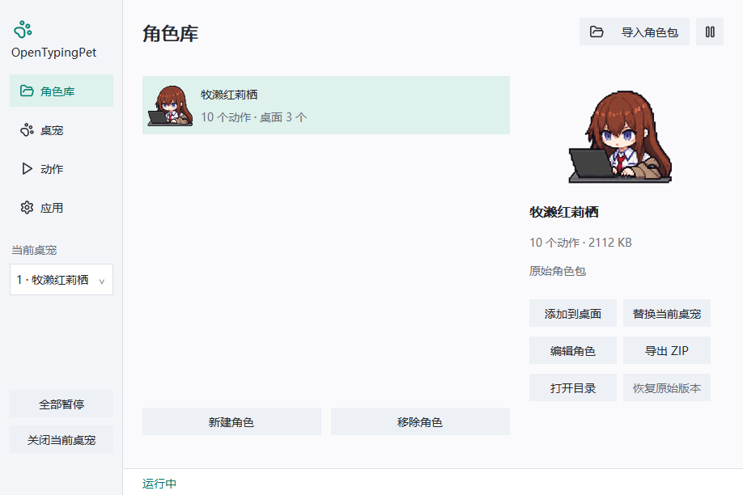
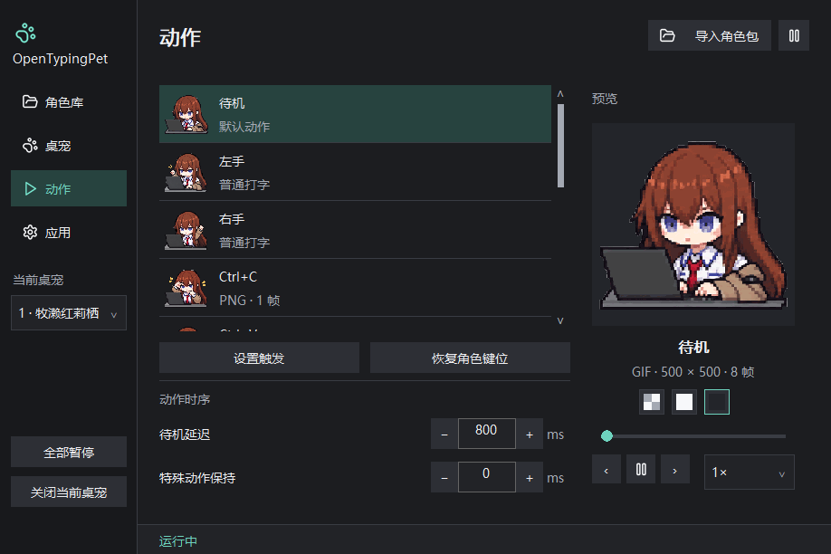

# OpenTypingPet

OpenTypingPet 是一个随键盘和鼠标操作做出反应的 Windows 桌宠 \
你可以把自己的图片和动画制作成角色包 \
本软件兼容 [TypingPet](https://github.com/swoonqx/TypingPet) 预设支持的格式

**当前提供免安装 Windows x64 版本**

[发布页面](https://github.com/KaffuAlcaid/OpenTypingPet/releases)

## 开始使用

1. 解压程序压缩包，运行 `OpenTypingPet.exe`
2. 点击“导入角色包”，选择角色 ZIP；首次导入的角色会出现在桌面上，后续导入的角色保存在角色库中
3. 享受和你的桌宠共度的打字时刻

## 使用指南

关闭设置窗口后，桌宠会继续运行。开启鼠标穿透后，可以通过系统托盘打开设置；退出程序时，在角色右键菜单或托盘菜单中选择“退出”

进入软件设置界面：\
“角色库”页面管理已导入的角色，可以添加到桌面、替换当前桌宠、编辑角色和导出 ZIP\
“桌宠”页面调整当前桌宠的大小、透明度、置顶、鼠标穿透、显示器和贴边吸附\
“动作”页面查看动作与触发条件，可以设置键盘、鼠标触发，并能逐帧预览动画\
“应用”页面选择界面主题、启动方式和自动暂停条件



### 设置键盘和鼠标触发

在“动作”页面选中一个动作，点击“设置触发”，选择新增或编辑已有规则；点击“录入”后，按下键盘按键，或在录入窗口内点击鼠标按钮

鼠标支持左键、右键、中键及两个侧键，可以分别选择“鼠标按下”和“鼠标松开”，也可以同时要求按住 Ctrl、Shift 或 Alt。录入完成后可以继续修改触发事件；切换到其他窗口或按 Esc 会结束本次录入

动作序列可以添加、移除和调整顺序，每次触发依次使用其中一个动作。这里设置的规则只影响当前桌宠，“恢复角色键位”会清除当前桌宠的键位修改和停用状态



### 多个桌宠

角色库中的“添加到桌面”可以同时保留最多四个桌宠，同一角色也可以添加多次；侧栏的“当前桌宠”用于切换设置对象

每个桌宠分别保存位置、外观、暂停状态和键位。调整外观后，该桌宠改用自己的设置；勾选“使用角色默认设置”会重新采用角色默认值。“保存为角色默认”会同时更新仍使用该默认值的桌宠

“暂停响应”控制当前桌宠，“全部暂停”控制所有桌宠；结束全部暂停后，单独暂停过的桌宠继续保持暂停。“关闭当前桌宠”会移除桌面实例，角色仍保留在角色库中

桌宠靠近显示器工作区边缘时会吸附，拖动时按住 Alt 可以临时跳过吸附，拔掉显示器后，桌宠会移到可用屏幕内，重新连接原显示器后会恢复原位置

### 自动暂停

“应用”页面可以开启锁屏暂停、息屏暂停，以及全屏应用时隐藏并暂停；睡眠时会暂停，恢复后继续运行

全屏策略按桌宠所在显示器判断，“应用例外”填写程序文件名，多个名称以分号分隔，例如 `game.exe;player.exe`，这些程序全屏时桌宠继续显示

### 角色包管理

导入失败后可以打开“查看详情”，查看文件、字段及 JSON 语法错误的行列位置；修正源 ZIP 后点击“重新导入”

导入具有相同角色标识的新包时，可以更新已有角色或另存为新角色，编辑角色会保留原始导入版本，“恢复原始版本”可以撤回角色编辑；“移除角色”会同时关闭该角色的桌面实例

## 制作角色包

可以直接在“角色库”中点击“新建角色”，按“素材 → 动作 → 角色 → 规则”的顺序完成配置：先添加图片或动画，再创建动作，填写角色名称和默认动作，最后设置输入规则

编辑器提供独立动画预览、撤销与重做。“保存并应用”保存到角色库，并更新该角色正在运行的桌宠；“导出 ZIP”生成可以重新导入或分享的角色包，停用的规则会从导出包中省略

<details>
<summary>素材目录、完整配置示例与动作规则</summary>

### 准备素材

例如，下面制作一个包含四个动作（待机、左手打字、右手打字和微笑）的角色，普通打字时左右手交替，按下 Enter 时播放微笑：

先准备四份透明背景素材，建议使用相同的画布尺寸，并保持角色的位置一致，如此切换动作时角色的位置会稳定 \
示例使用 500 × 500 像素画布，文件结构如下：

```text
myPet.zip
├── character.json
└── images/
    ├── idle.apng
    ├── left.png
    ├── right.png
    └── smile.apng
```

静态素材可用 PNG,动画素材可用 APNG 或 GIF,`source` 中的文件名应与实际素材一致

### 编写角色配置

将下面的内容保存为 UTF-8 编码的 `character.json`：

```json
{
  "formatVersion": 1,
  "id": "yourName.myPet",
  "name": "我的桌宠",
  "canvas": {
    "width": 500,
    "height": 500
  },
  "defaultAction": "idle",
  "animations": [
    {
      "id": "idleImage",
      "source": "images/idle.apng"
    },
    {
      "id": "leftImage",
      "source": "images/left.png"
    },
    {
      "id": "rightImage",
      "source": "images/right.png"
    },
    {
      "id": "smileImage",
      "source": "images/smile.apng"
    }
  ],
  "actions": [
    {
      "id": "idle",
      "name": "待机",
      "animation": "idleImage",
      "loopCount": 0
    },
    {
      "id": "left",
      "name": "左手",
      "animation": "leftImage"
    },
    {
      "id": "right",
      "name": "右手",
      "animation": "rightImage"
    },
    {
      "id": "smile",
      "name": "微笑",
      "animation": "smileImage",
      "loopCount": 1,
      "interruptible": false,
      "nextAction": "idle"
    }
  ],
  "rules": [
    {
      "id": "typing",
      "event": "typing",
      "actions": ["left", "right"],
      "repeat": "restart"
    },
    {
      "id": "enter",
      "event": "keyDown",
      "key": "Enter",
      "actions": ["smile"],
      "priority": 100
    }
  ]
}
```

这份配置分为三部分：

- `animations` 指定素材文件。`source` 是相对于 `character.json` 所在目录的路径
- `actions` 指定动作名称及播放方式，通过 `animation` 引用素材的 `id`
- `rules` 指定触发条件，通过 `actions` 引用动作的 `id`。数组有多项时，每次触发取下一项，循环轮换

`id` 用于相互引用，`name` 是界面显示的名称。角色、素材、动作和规则的标识可以使用英文字母、数字、点、连字符和下划线，长度为 1 至 80 字节 \
各类标识在自己的列表中保持唯一，显示名称可以使用中文

`formatVersion` 填写 `1`。`canvas` 决定角色画布的宽高比例；省略时，程序采用默认动作素材的尺寸 \
`defaultAction` 指定待机动作，停止输入后，角色按照设置中的“待机延迟”返回该动作

### 调整触发条件

| `event` | 含义 | 按键示例 |
|---|---|---|
| `typing` | 具体按键规则优先，其余普通按键使用此规则 | 直接填写动作序列 |
| `keyDown` | 按下键盘按键 | `Enter`、`Space`、`A` |
| `keyUp` | 松开键盘按键 | `Enter`、`Space`、`A` |
| `mouseDown` | 按下鼠标按钮 | `MouseLeft`、`MouseRight` |
| `mouseUp` | 松开鼠标按钮 | `MouseLeft`、`MouseRight` |

键盘按键名称包括 `A` 至 `Z`、`0` 至 `9`、`F1` 至 `F24`，以及 `Backspace`、`Tab`、`Enter`、`Shift`、`Ctrl`、`Alt`、`CapsLock`、`Esc`、`Space`、`PageUp`、`PageDown`、`End`、`Home`、`Left`、`Up`、`Right`、`Down`、`Insert`、`Delete`

鼠标按钮名称为 `MouseLeft`、`MouseRight`、`MouseMiddle`、`MouseX1`、`MouseX2`

例如，下面的规则在松开鼠标左键时播放微笑：

```json
{
  "id": "mouseSmile",
  "event": "mouseUp",
  "key": "MouseLeft",
  "actions": ["smile"],
  "priority": 100
}
```

组合键通过 `modifiers` 配置，支持 `ctrl`、`shift`、`alt`,下面的规则在按下 Ctrl+C 时播放微笑：

```json
{
  "id": "copy",
  "event": "keyDown",
  "key": "C",
  "modifiers": {"ctrl": true},
  "actions": ["smile"],
  "priority": 100
}
```

将它加入 `rules` 数组即可,省略的修饰键取 `false`；每组事件、按键与修饰键对应一条规则

### 调整播放方式

| 字段 | 所在位置 | 作用 |
|---|---|---|
| `loopCount` | 动作 | `0` 表示无限循环，`1` 至 `100000` 表示总播放次数,省略时采用素材自身的循环信息 |
| `nextAction` | 动作 | 指定播放结束后的目标动作 `id` |
| `interruptible` | 动作 | 默认为 `true`。设为 `false` 后，当前动作完整播放，期间收到的输入保留最后一个待执行动作 |
| `minimumHoldMs` | 动作 | 设置动作的最短保持时间，范围为 0 至 5000 毫秒,特殊动作同时采用界面保持时间与此值中的较大者 |
| `priority` | 规则 | 范围为 0 至 1000，默认为 `0`。当前动作处于最短保持期时，较低优先级的动作等待保持结束后执行 |
| `repeat` | 规则 | `restart` 表示重新播放；`continue` 表示同一动作保持播放进度；`ignore` 表示长按仅触发一次,普通打字默认采用 `restart`，其他事件默认采用 `ignore` |

带有 `nextAction` 或设为 `interruptible: false` 的动作使用有限循环次数，省略 `loopCount` 时按一次播放处理。动作结束时，后续输入触发的待执行动作优先于 `nextAction`

### 打包与验证

选中 `character.json` 和 `images` 文件夹，将它们一起压缩成 ZIP，也可以在它们所在的目录执行：

```powershell
Compress-Archive -Path .\character.json, .\images -DestinationPath .\myPet.zip
```

导入程序后，先在“动作”页面逐一预览，再通过打字和 Enter 检查触发效果。用浅色、深色和透明网格背景检查边缘，确认各动作的角色位置保持一致

当前资源规格：

| 项目 | 上限 |
|---|---|
| 图像宽度与高度 | 各 2048 像素 |
| 单个动画 | 300 帧 |
| 单个资源文件 | 15 MiB |
| `character.json` | 64 KiB |
| ZIP 文件 | 64 MiB |
| ZIP 解压后的文件总量 | 96 MiB |
| ZIP 条目数量，包含目录项 | 256 |
| 角色解码后的图像总量 | 128 MiB |
| 所有角色共享的解码缓存 | 256 MiB |
| 动画资源、动作、规则数量 | 分别为 64、64、128 |
| 单条规则引用的动作数量 | 16 |

注：控制画布尺寸和帧数能减少运行内存，多个动作可以引用同一份动画资源

</details>

## 本地数据与更新

程序在本机接收输入事件，并将其映射为角色动作，按键状态用于内存中的动作判断。多个桌宠共用输入注册和已解码的动画；所有桌宠暂停或隐藏后，程序会停止全局输入接收

界面主题、启动方式和自动暂停选项保存在当前 Windows 用户的注册表中。角色库、桌宠实例和键位修改保存在 `%LOCALAPPDATA%\OpenTypingPet\OpenTypingPet\userState.json`，同目录的 `characters` 保存角色包副本，`thumbnails` 保存缩略图

保存配置时会保留一份 `.bak` 备份；配置损坏时程序尝试读取备份，并保留损坏文件

更新时，先从托盘退出程序，再替换程序文件，已有设置和角色会保留

## 问题反馈

请在 [Issues](https://github.com/KaffuAlcaid/OpenTypingPet/issues) 中提供程序版本、Windows 版本和复现步骤，角色相关的问题可以附上动作名称、素材格式及运行截图

## 许可证

项目由 KaffuAlcaid 开发，采用 [GPL-3.0-only](LICENSE) 许可证。第三方组件保留各自的许可证和版权声明，角色素材的权利归原作者所有

发布包中的 `LICENSES.txt` 汇总程序与第三方组件的许可证

## 致谢

特别鸣谢克里斯提娜（牧濑红莉栖）提供的精神支持

感谢 [John_milk](https://space.bilibili.com/3276649) 制作并分享牧濑红莉栖桌宠素材，原视频：[【牧濑红莉栖】可以响应键盘输入的桌面小助手](https://www.bilibili.com/video/BV1ebpc6QETF)

感谢 [TypingPet](https://github.com/swoonqx/TypingPet) 提供灵感:

它生动诠释了什么叫做源码“值得珍藏”\
也给我们一个宝贵启发，原来只要公开 README 和更新日志，就能将 GitHub 仓库设置成 Public

OpenTypingPet 因此有了一个很明确的目标：让用户既能看见角色怎么动，也能看见程序怎么处理键盘输入

本项目为独立实现，与 TypingPet 不存在官方关联
